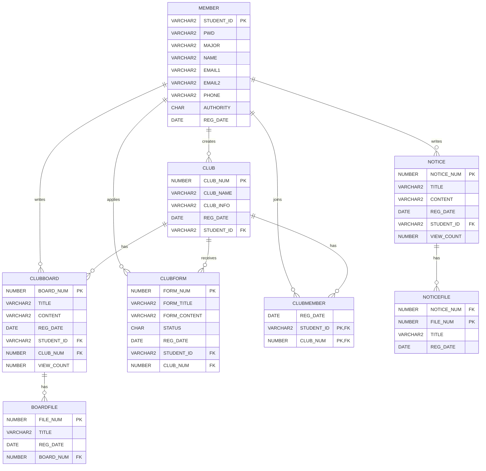

# SCHOOL CLUB

---

## 1. 프로젝트 소개
> 교내에 흩어져 있는 동아리 정보를 통합하고, 동아리 홍보부터 가입 신청 및 회원 관리까지 하나의 서비스에서 이용할 수 있도록 구현한 **교내 동아리 통합 관리 플랫폼**입니다. <br>
>
> JSP/Servlet으로 개발한 기존 프로젝트를 **Spring MVC로 리팩토링**하여, 기능별 Servlet 구조를 **Controller - Service - DAO 계층 구조로 개선**했습니다.

<br>

| 구분 | 내용 |
| --- | --- |
| 개발 형태 | 개인 프로젝트 |
| 개발 기간 | 25.07.01 ~ 25.07.31 |
| 담당 범위 | 기획 · DB 설계 · Backend |
| 주요 작업 | JSP/Servlet → Spring MVC 리팩토링 |

---

## 2. 기술 스택

**Backend**  
`Java 1.8` `Spring Framework(Spring MVC)` `MyBatis`

**Frontend**  
`JSP` `JavaScript` `jQuery` `Bootstrap`

**Database**  
`Oracle 11g`

**WAS**  
`Apache Tomcat 9.0`

**Tools**  
`STS` `SQL Developer`

---

## 3. 주요 기능

### 회원

- 회원가입 및 로그인 / 로그아웃
- 학번 중복 확인
- 회원 정보 조회 및 수정

### 동아리

- 동아리 CRUD
- 동아리 가입 신청
- 가입 신청 승인 / 거절
- 동아리 회원 관리
- 개설 및 가입 동아리 조회

### 동아리 게시판

- 게시글 CRUD
- Ajax 기반 첨부파일 업로드

### 관리자

- 회원 관리
- 공지사항 CRUD 및 Ajax 기반 첨부파일 업로드
- 동아리 및 게시판 관리

---

## 4. ERD



---

## 5. Servlet → Spring MVC 리팩토링

### 5.1 리팩토링 배경

> 기존 JSP/Servlet 프로젝트는 각 기능마다 별도의 Servlet에서 요청을 처리하고 DAO를 호출하는 구조로, 기능이 추가됨에 따라 Servlet이 약 30개까지 증가했습니다. <br>
> 관련 기능의 코드가 여러 Servlet에 분산되어 있어, 이를 체계적으로 관리할 수 있도록 구조를 개선했습니다.

<br>

### 5.2 구조 변화

#### Before — JSP/Servlet

> `Servlet` → `DAO` → `DB`

<details>
<summary><b>Servlet 프로젝트 상세 구조 보기</b></summary>

```text
src
├── controller
│   ├── AdminMemberDeleteServlet.java
│   ├── AdminMemberListServlet.java
│   ├── AdminMemberReadServlet.java
│   ├── BoardDeleteServlet.java
│   ├── BoardListServlet.java
│   ├── BoardReadServlet.java
│   ├── BoardUpdateServlet.java
│   ├── BoardWriteServlet.java
│   ├── ClubCheckListServlet.java
│   ├── ClubDeleteServlet.java
│   ├── ClubFormReadServlet.java
│   ├── ClubFormWriteServlet.java
│   ├── ClubListServlet.java
│   ├── ClubMemberApproveServlet.java
│   ├── ClubMemberDeleteServlet.java
│   ├── ClubMemberReadServlet.java
│   ├── ClubMemberRejectServlet.java
│   ├── ClubReadServlet.java
│   ├── ClubRegisterServlet.java
│   ├── ClubUpdateServlet.java
│   ├── IdCheckServlet.java
│   ├── JoinServlet.java
│   ├── LoginServlet.java
│   ├── LogoutServlet.java
│   ├── MainServlet.java
│   ├── MemberReadServlet.java
│   ├── MemberUpdateServlet.java
│   ├── MyClubListServlet.java
│   ├── MyClubReadServlet.java
│   └── MyJoinClubServlet.java
│
├── dao
│   ├── ClubBoardDAO.java
│   ├── ClubDAO.java
│   └── MemberDAO.java
│
└── dto
    ├── ClubBoardVO.java
    ├── ClubFormVO.java
    ├── ClubMemberVO.java
    ├── ClubVO.java
    └── MemberVO.java

WebContent
├── admin
├── club
├── clubBoard
├── member
├── mypage
├── login.jsp
└── main.jsp
```

</details>

#### After — Spring MVC

> `Controller` → `Service / ServiceImpl` → `DAO / DAOImpl` → `MyBatis Mapper` → `DB`

<details>
<summary><b>Spring MVC 프로젝트 상세 구조 보기</b></summary>

```text
src/main/java/com/mis
├── controller
│   ├── AdminClubController.java
│   ├── AdminMemberController.java
│   ├── ClubBoardController.java
│   ├── ClubController.java
│   ├── ClubFormController.java
│   ├── ClubMemberController.java
│   ├── HomeController.java
│   ├── MemberController.java
│   ├── MypageController.java
│   ├── NoticeController.java
│   └── UploadController.java
│
├── domain
│   ├── BoardFileVO.java
│   ├── ClubBoardVO.java
│   ├── ClubFormVO.java
│   ├── ClubMemberVO.java
│   ├── ClubVO.java
│   ├── MemberVO.java
│   ├── NoticeFileVO.java
│   └── NoticeVO.java
│
├── dto
│   └── LoginDTO.java
│
├── persistence
│   ├── ClubBoardDAO.java
│   ├── ClubBoardDAOImpl.java
│   ├── ClubDAO.java
│   ├── ClubDAOImpl.java
│   ├── ClubFormDAO.java
│   ├── ClubFormDAOImpl.java
│   ├── ClubMemberDAO.java
│   ├── ClubMemberDAOImpl.java
│   ├── MemberDAO.java
│   ├── MemberDAOImpl.java
│   ├── NoticeDAO.java
│   └── NoticeDAOImpl.java
│
├── service
│   ├── ClubBoardService.java
│   ├── ClubBoardServiceImpl.java
│   ├── ClubFormService.java
│   ├── ClubFormServiceImpl.java
│   ├── ClubMemberService.java
│   ├── ClubMemberServiceImpl.java
│   ├── ClubService.java
│   ├── ClubServiceImpl.java
│   ├── MemberService.java
│   ├── MemberServiceImpl.java
│   ├── NoticeService.java
│   └── NoticeServiceImpl.java
│
└── util
    ├── MediaUtils.java
    └── UploadFileUtils.java

src/main/resources
└── mappers
    ├── clubBoardMapper.xml
    ├── clubFormMapper.xml
    ├── clubMapper.xml
    ├── clubMemberMapper.xml
    ├── memberMapper.xml
    └── noticeMapper.xml

src/main/webapp
├── resources
└── WEB-INF
    ├── classes
    ├── spring
    └── views
        ├── admin
        ├── club
        ├── clubBoard
        ├── clubForm
        ├── clubMember
        ├── include
        ├── member
        ├── mypage
        ├── notice
        ├── upload
        └── main.jsp
```

</details>

<br>

### 5.3 기능 개선

Spring MVC 리팩토링 과정에서 공지사항 기능을 추가하고, 게시판의 첨부파일 처리 방식을 개선했습니다.

#### 공지사항 기능 추가

- 공지사항 CRUD 구현
- 첨부파일 업로드 구현

#### 게시판 첨부파일 기능 개선

- 단일 이미지 업로드에서 다중 파일 업로드 방식으로 개선

---

## 6. 리팩토링 코드 비교

### Before — JSP/Servlet

기존에는 동아리 가입 승인과 거절 요청을 각각 별도의 Servlet에서 처리하고, Servlet에서 DAO를 직접 호출했습니다.

#### Servlet — 가입 승인

```java
@WebServlet("/clubMemberApprove.do")
public class ClubMemberApproveServlet extends HttpServlet {

    protected void doPost(HttpServletRequest request, HttpServletResponse response)
            throws ServletException, IOException {

        int formNum = Integer.parseInt(request.getParameter("formNum"));
        String studentId = request.getParameter("studentId");
        int clubNum = Integer.parseInt(request.getParameter("clubNum"));

        ClubDAO cDao = ClubDAO.getInstance();

        ClubFormVO fVo = new ClubFormVO();
        fVo.setFormNum(formNum);
        cDao.approveClubMember(fVo);

        ClubMemberVO hVo = new ClubMemberVO();
        hVo.setStudentId(studentId);
        hVo.setClubNum(clubNum);
        cDao.insertClubMember(hVo);

        response.sendRedirect("myClubRead.do?clubNum=" + clubNum);
    }
}
```

#### DAO — JDBC

```java
// 가입 승인 상태 변경
public void approveClubMember(ClubFormVO vo) {

    String sql = "UPDATE CLUBFORM SET STATUS = 2 WHERE FORMNUM = ?";

    Connection conn = null;
    PreparedStatement pstmt = null;

    try {
        conn = DBManager.getConnection();
        pstmt = conn.prepareStatement(sql);
        pstmt.setInt(1, vo.getFormNum());
        pstmt.executeUpdate();
    } catch (Exception e) {
        e.printStackTrace();
    } finally {
        DBManager.close(conn, pstmt);
    }
}

// 승인된 회원을 동아리 회원으로 추가
public void insertClubMember(ClubMemberVO vo) {

    String sql = "INSERT INTO CLUBMEMBER VALUES(SYSDATE, ?, ?)";

    Connection conn = null;
    PreparedStatement pstmt = null;

    try {
        conn = DBManager.getConnection();
        pstmt = conn.prepareStatement(sql);
        pstmt.setString(1, vo.getStudentId());
        pstmt.setInt(2, vo.getClubNum());
        pstmt.executeUpdate();
    } catch (Exception e) {
        e.printStackTrace();
    } finally {
        DBManager.close(conn, pstmt);
    }
}
```

### After — Spring MVC

가입 승인·거절 요청을 하나의 Controller로 통합하고, 관련 비즈니스 로직을 Service 계층으로 분리하여 코드 관리가 용이하도록 개선했습니다.

#### Controller

```java
@PostMapping("/approve")
public String approve(@RequestParam("formNum") int formNum, ClubMemberVO vo) throws Exception {
    formService.updateApprove(formNum, vo);
    return "redirect:/mypage/clubRead?clubNum=" + vo.getClubNum();
}
```

#### ServiceImpl

```java
@Override
public void updateApprove(int formNum, ClubMemberVO vo) throws Exception {
    dao.updateApprove(formNum); // 승인상태변경
    clubMemberDao.create(vo); // 회원테이블에 추가
}
```

#### Mapper — MyBatis

```xml
<!-- 가입 승인 상태 변경 -->
<update id="updateApprove">
    UPDATE CLUBFORM
    SET STATUS = 2
    WHERE FORMNUM = #{formNum}
</update>

<!-- 동아리 회원 등록 -->
<insert id="create">
    INSERT INTO CLUBMEMBER (STUDENTID, CLUBNUM, REGDATE)
    VALUES (#{studentId}, #{clubNum}, SYSDATE)
</insert>
```

---

## 7. 시연 영상

### 사용자

https://github.com/user-attachments/assets/d755b8b0-f7f2-4939-960a-22f2abdcd381

### 관리자

https://github.com/user-attachments/assets/67209d6c-8813-43ff-8948-a1fed5cb82f0

---

## 8. Troubleshooting

### 8.1 회원 삭제 시 FK 제약조건 오류

#### 문제

관리자가 회원을 삭제하는 과정에서 해당 회원의 게시글을 함께 삭제하려 했으나, 게시글과 연결된 첨부파일 데이터가 남아 있어 `ORA-02292` 오류가 발생했습니다.


#### 원인

`BOARDFILE`이 `CLUBBOARD`의 `BOARDNUM`을 FK로 참조하고 있지만, 회원 삭제 로직에서는 첨부파일을 먼저 삭제하는 과정이 누락되어 참조 데이터가 남아 있는 상태에서 게시글 삭제가 시도되었습니다.

#### 해결

회원 삭제 시에도 FK 관계를 고려하여 첨부파일 → 게시글 → 회원 순서로 데이터를 삭제하도록 변경했습니다.

먼저 `STUDENTID`로 회원이 작성한 게시글을 조회하고, 해당 게시글의 `BOARDNUM`을 참조하는 첨부파일을 삭제하도록 쿼리를 추가했습니다.

```sql
DELETE FROM BOARDFILE
WHERE BOARDNUM IN (
    SELECT BOARDNUM
    FROM CLUBBOARD
    WHERE STUDENTID = #{studentId}
);
```

또한 여러 테이블의 데이터가 함께 삭제되는 작업이므로 @Transactional을 적용하여, 중간에 오류가 발생하면 전체 작업이 롤백되도록 처리했습니다.

```java
@Transactional
@Override
public void delete(String studentId) throws Exception {
    clubFormDao.deleteMember(studentId);
    clubMemberDao.deleteMember(studentId);
    clubBoardDao.deleteMemberFile(studentId);
    clubBoardDao.deleteMember(studentId);
    clubDao.deleteMember(studentId);
    dao.delete(studentId);
}
```

---

### 8.2 첨부파일 원본 파일명 표시 오류

#### 문제

게시글 수정 화면에서 기존 첨부파일의 원본 파일명 앞에 `0_`, `b_` 등의 불필요한 문자가 함께 표시되는 문제가 발생했습니다.

#### 원인

SUBSTR을 사용해 저장 경로와 UUID를 제거했지만, 문자열을 고정된 위치에서 잘라내는 방식이라 파일명에 따라 일부 문자가 남았습니다.

```sql
SUBSTR(TITLE, 50) AS TITLE
```

#### 해결

파일 저장 형식을 기준으로 경로와 UUID를 제거하도록 REGEXP_REPLACE를 적용했습니다.

```sql
REGEXP_REPLACE(TITLE, '^.*/[sb]_[^_]+_', '') AS TITLE
```

실제 파일 경로는 조회와 삭제에 사용하도록 유지하고, 화면에는 `TITLE`을 통해 원본 파일명만 표시하도록 변경했습니다.

